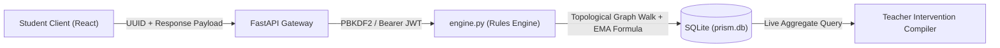

# PRISM CLASSROOM — TECHNICAL INTERVIEW DEFENSE GUIDE
> **Code Kernel '26 · Decode Round | 50% Technical Interview Preparation**  
> *10-Minute Google Meet Master Guide & Architectural Defense*

---

## ⚡ Executive Summary (Your 30-Second Opening Hook)
> *"Good morning judges. We built **PRISM Classroom**, an evidence-informed adaptive learning copilot engineered for Indian classrooms of 45 to 60 learners. Unlike conventional EdTech that isolates children behind black-box AI chatbots, PRISM is built around one core conviction: **keep the teacher at the centre of every instructional decision**. Backed by a deterministic rules engine and an acyclic concept graph, PRISM diagnoses latent misconceptions through short interactive probes, adapts visual manipulatives in English, Hindi, and Telugu, and compiles live learner evidence into our signature **Teacher Intervention Compiler**—giving teachers editable small-group pods and official CBSE inspection briefings."*

---

## Question 1: What Have You Built and How Does It Work?

### 1.1 The System in One Sentence
PRISM Classroom is a **closed-loop adaptive diagnostic and intervention platform** mapped to **CBSE Class VIII Mathematics (NCERT Middle Stage)** that turns granular student problem-solving evidence into differentiated teacher actions.

### 1.2 End-to-End Operational Lifecycle (Walkthrough)
1. **Evidence Ingestion:** A student logs in or enrolls via their teacher's Classroom Code (`CLASS-XXXXXX`). They attempt diagnostic items.
2. **Offline Resilience & Deduplication:** Attempts are tagged with client-side UUIDs (`submission_id`) and buffered in `localStorage`. Upon sync, SQLite enforces `UNIQUE(student_id, submission_id)` to ensure zero duplicate scoring.
3. **Deterministic Diagnosis:** Rather than just marking answers right or wrong, `engine.py` evaluates specific latent error patterns (e.g., *denominator-magnitude confusion: believing $1/8 > 1/3$ because $8 > 3$*).
4. **Three-Pillar Adaptation (LEARN · SOLVE · TEST):**
   - **LEARN:** Changes representation (interactive SVG Fraction Bar Comparator).
   - **SOLVE:** Steps through scaffolded multiplier grids $(a \times k) / (b \times k)$.
   - **TEST:** Verifies independent transfer on an unguided application item (1.4× evidentiary weight) before awarding mastery.
5. **Teacher Intervention Compiler:** Aggregates individual evidence pulses across the section into 4 small-group pods:
   - *Visual Support Pod (10 min)*
   - *Foundation Track Pod (12 min)*
   - *Guided Practice Pod (12 min)*
   - *Extension Challenge Pod (15 min)*
6. **Teacher Decision Authority:** In the Teacher Control Room, the educator can approve the plan with one click, modify durations (5–20 min), reassign students between pods, dismiss suggestions, inspect historical Attempt Dossiers, or export official CBSE inspection briefings.
7. **Closed-Loop Feedback:** Real-time re-clustering (`POST /api/teacher/interventions/recompile`) refreshes pods on the fly as live student attempts stream in.

---

## Question 2: Why Did You Choose Your Technologies and Architecture?

| Technology | Selection Rationale & Pedagogical Justification | Alternatives Considered & Rejected |
| :--- | :--- | :--- |
| **FastAPI (Python 3.11)** | High-throughput async ASGI framework with automatic OpenAPI documentation, Pydantic type validation, and direct integration with Python graph algorithms (`engine.py`). | **Node.js/Express**: Lacks native Python scientific/graph manipulation libraries for pedagogical algorithms. |
| **Deterministic Rules Engine (DAG + EMA)** | **Zero hallucinations**. In curriculum education, probabilistic generative LLMs produce unpredictable mathematical errors. Our DAG topological walk and rubric EMA are 100% reproducible and audit-proof. | **Generative LLM Agents (GPT/Claude)**: Unpredictable, expensive per query, slow latency (1–3s), hallucination risks in fraction operations. |
| **React 18 + TypeScript 5.6** | Type-safe component architecture for complex interactive SVG manipulatives (fraction bars, strip folding) with sub-millisecond DOM reactivity. | **Server-rendered templates (Jinja/Blade)**: Cannot provide instant, client-side visual manipulatives without round-trip lag. |
| **SQLite with SQLAlchemy 2.0** | Zero-configuration, ACID-compliant relational persistence with 9 normalized tables. Perfect for school intranet edge servers or containerized microservices. | **NoSQL (MongoDB)**: Lacks relational integrity constraints required for prerequisite DAG foreign keys and audit trails. |
| **Trilingual Dictionary (EN / HI / TE)** | Aligned with **National Education Policy (NEP 2020)** multilingual mandate. Uses authentic NCERT terminology (*अंश/हर, లవం/హారం*). | **Machine Translation APIs**: Prone to context-blind literal translations that distort mathematical meanings. |
| **AEO & GEO Optimization** | Native `robots.txt`, `sitemap.xml`, `/llms.txt`, and Schema.org JSON-LD (FAQPage, Course, EducationalOrganization) enabling search engines and AI agents (Perplexity, ChatGPT, Google AI Overviews) to index authoritative content. | **Unstructured SPAs**: Invisible to modern Answer Engines and Generative Search agents. |

---

## Question 3: How Is Your Data Collected, Processed, and Stored?

### 3.1 Data Collection & Ingestion
- Every student interaction creates an attempt payload:
  `{ question_id, response, stage, submission_id }`
- Client generates a UUIDv4 (`submission_id`) stored in `localStorage` queue.
- If Wi-Fi drops, attempts are buffered offline and flushed upon reconnection.
- Endpoint `/api/learning/attempts` checks database for existing `(student_id, submission_id)`. If present, returns cached result without double-scoring.

### 3.2 Processing Logic & Mathematical Model
Mastery is updated via a **bounded Exponential Moving Average (EMA)** with evidentiary weighting:

$$Mastery = \text{round}\left(\max\left(0.05, \min\left(0.95, 0.25 \times M_{prev} + 0.75 \times \frac{\sum w_i \cdot c_i}{\sum w_i}\right)\right), 2\right)$$

- $w_i = 1.0$ for diagnostic and practice items.
- $w_i = 1.4$ for independent transfer verification items (40% higher weight).
- $c_i \in \{0, 1\}$ represents correctness.
- **Pedagogical Safeguard 1 (Single-Error Shield):** A single mistake *never* establishes a misconception label.
- **Pedagogical Safeguard 2 (Confidence Floor):** Requires $\ge 2$ matching error tags with $\ge 50\%$ concentration before prescribing an adaptive route.
- **Pedagogical Safeguard 3 (Ambiguity Routing):** Conflicting evidence routes learner to `follow-up` (Teacher Conference).

### 3.3 Storage Schema (9 Normalized Tables)
1. `classrooms`: Class code, grade (8), curriculum framework.
2. `teachers`: Demo identity, name, classroom relationship.
3. `users`: Credentials, salt + PBKDF2 hash (210,000 iterations), role, code link.
4. `students`: Student code, language preference, classroom link.
5. `concepts`: Concept ID, objective, grade, prerequisites JSON array.
6. `questions`: Prompt, options, stage, expected answer, misconception tag map, transfer flag.
7. `attempts`: Foreign keys to student and question, response, correctness, submission UUID.
8. `learner_progress`: Concept mastery, evidence count, misconception tag, confidence, route.
9. `interventions`: Pod assignments, barrier description, activity, duration, teacher notes, approval status.

---

## Question 4: What Challenges Did You Face and How Did You Solve Them?

### Challenge 1: The False-Positive Misconception Trap
- *Problem:* Early testing showed that if a student made an accidental slip of the mouse, the system would immediately label them with "denominator-magnitude confusion" and force them into remedial tracks.
- *Solution:* We engineered a **two-tier evidence threshold** in `engine.py`. A student must exhibit at least two independent errors carrying the same diagnostic tag with $\ge 50\%$ relative occurrence. If evidence is ambiguous, the system triggers a "Teacher Conference" fallback instead of making an ungrounded assumption.

### Challenge 2: Connectivity Drops in Indian Classrooms
- *Problem:* In semi-urban and rural schools, school Wi-Fi frequently drops during class, causing lost test submissions or duplicate submissions when students mash the retry button.
- *Solution:* We built an **offline-first queueing engine** using `localStorage` coupled with client-generated UUIDs. Submissions are stored locally until connectivity returns. The backend uses a SQL `UniqueConstraint("student_id", "submission_id")`, guaranteeing idempotent execution.

### Challenge 3: Teacher Disenfranchisement
- *Problem:* Most EdTech algorithms create "black-box" tracks that teachers cannot inspect or override, leading teachers to abandon the software.
- *Solution:* We created the **Teacher Intervention Compiler**. PRISM only *proposes* differentiated groups. The teacher can adjust times (5 to 20 minutes), drag-and-drop students between pods, add pedagogical observations, or reject the plan entirely. Every recommendation links directly to the student's raw **Attempt Dossier**.

### Challenge 4: Real Data vs Simulation
- *Problem:* The hackathon evaluation specifically penalizes "simulations, dummy data, and fake functionality."
- *Solution:* We replaced all static/hardcoded demo states with **real database operations**: real student account registration, custom classroom join codes, dynamic attempt logging, and a live `recompile_interventions` endpoint that clusters real students from live SQLite rows in real time.

---

## Question 5: What Makes Your Implementation Different From Others?

| Feature | Conventional Commercial EdTech | Autonomous AI Chatbots | **PRISM Classroom** |
| :--- | :--- | :--- | :--- |
| **Classroom Role** | Replaces teacher with solo screen time | Replaces teacher with conversational bot | **Augments the teacher (Teacher-in-the-Loop)** |
| **Diagnostic Reliability** | Percentage score only (e.g., "60%") | LLM prompt heuristic (unpredictable) | **Deterministic rules + Prerequisite DAG** |
| **Pedagogical Safety** | Labels students as "weak" / "slow" | Prone to mathematical hallucinations | **Single-error safeguard + Explainable Dossier** |
| **Actionable Output** | Generic homework assignments | Endless chat transcripts | **45-minute lesson pacing pods + CBSE export** |
| **Language Support** | English only | Generic machine translation | **Trilingual NCERT terms (EN, HI, TE)** |
| **Offline Resilience** | Blocks on network drop | Blocks completely | **UUID deduplication + LocalStorage sync** |
| **AEO / GEO Engine** | Not implemented | Not implemented | **JSON-LD Schema + llms.txt standard** |

---

## 🎯 Rapid-Fire Judge Q&A Drill

**Judge: "What happens if two students have completely different misconceptions in the same class?"**  
*Answer:* "The Teacher Intervention Compiler clusters students dynamically by prescribed route. Aarav (denominator confusion) routes to the Visual Pod with SVG fraction bars, while Diya (partitioning gap) routes to the Foundation Pod with equal-part strips. If pod numbers are small, the teacher can merge them or adjust duration using the Edit Plan Modal."

**Judge: "Why not use an LLM like GPT-4 to diagnose the students?"**  
*Answer:* "Three critical reasons: First, **safety & reliability**—LLMs hallucinate mathematical justifications. Second, **latency & cost**—in a classroom of 50 students submitting 5 answers each, 250 LLM API calls create multi-second lag and unsustainable API costs. Third, **explainability**—our deterministic rules engine can defend every diagnosis in a court of academic inspection."

**Judge: "How does PRISM ensure students don't guess their way to mastery?"**  
*Answer:* "Our 3-pillar model requires **independent transfer verification**. A student cannot advance to 'Demonstrated Mastery' by repeating familiar drills. They must solve a novel application problem (e.g. recipe scaling in non-standard units) that carries a 1.4× weight in our EMA mastery formula."

---
*PRISM Classroom · Developed for Code Kernel '26 | All 18 automated tests passing.*

