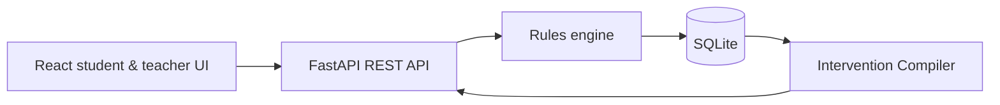

# PRISM Classroom

PRISM is a working vertical-slice prototype for **CBSE-aligned Class VIII Mathematics**. Its single module, **Rational Numbers: Equivalent Fractions and Standard Form**, uses an NCERT middle-stage reference and supports an evidence-led student learning loop plus a teacher-controlled **Intervention Compiler**. All included people and learning data are synthetic.

## Curriculum framework

The project is deliberately built around one system: **Central Board of Secondary Education (CBSE), India**. The board alignment, academic year, grade, subject, chapter reference, learning outcomes, and learner-facing labels are served from one API configuration (`backend/app/curriculum.py`) so the student and teacher experiences cannot silently diverge.

- Board: CBSE · Academic year 2026–27
- Reference: NCERT Mathematics, Class VIII — *Rational Numbers*
- Module outcomes: represent equivalent rational numbers; reduce to standard form; compare rational numbers; explain reasoning with symbols, words, or a visual model.
- Teaching approach: conceptual understanding, reasoning, and real-life application.

This is a synthetic educational prototype, not an official CBSE product or a statement of school affiliation. Schools must verify their prescribed text, annual plan, and assessment policy before classroom use. CBSE's official academic materials are available at [CBSE Academics](https://cbseacademic.nic.in/).

## Highlights

- Student workflow: diagnostic → adaptive learn → guided/independent solve → transfer verification.
- Deterministic, explainable rules for prerequisite gaps, possible misconceptions, mastery, uncertainty, and extension routes.
- Teacher workspace that groups similar needs, shows the supporting evidence, and lets a teacher edit, approve, or reject a plan.
- FastAPI + SQLAlchemy + SQLite persistence; React + TypeScript UI.
- Pseudonymous demo identities; no real child data.

## Architecture



## Run locally

Requirements: Node 20+ and Python 3.11+.

```powershell
cd backend
python -m venv .venv
.\.venv\Scripts\Activate.ps1
pip install -r requirements.txt
python -m app.seed
uvicorn app.main:app --reload --port 8000
```

In another terminal:

```powershell
cd frontend
npm install
npm run dev
```

Open `http://localhost:5173`. The app is pre-populated with synthetic data; choose **Student demo** or **Teacher dashboard** on the entry screen.

## Tests

```powershell
cd backend
pytest -q
cd ..\frontend
npm run test
npm run build
```

## Core data model

`Student`, `Teacher`, `Classroom`, `Concept`, `Question`, `Attempt`, `LearnerProgress`, and `Intervention` are persisted with relational foreign keys. Attempt submissions are idempotent via a client submission ID.

## Design decisions

Recommendations are provisional rule outputs, not diagnoses or calibrated probabilities. A single wrong answer cannot create a misconception label. Contradictory or low-volume evidence creates a review/follow-up recommendation. Teacher decisions override and are retained.

## Privacy and limitations

- Seed records are fictional and intentionally pseudonymous.
- Demo identity headers are not production authentication. A deployment must replace them with a vetted identity provider, HTTPS, rate limiting, and role audits.
- English content is reviewed for this prototype. Telugu is represented as a language preference only; a reviewed Telugu pack is not included.
- Offline response queuing and production deployment/video capture are not included.
- This prototype has not been evaluated for learning outcomes.

## Deployment

Deploy the API with a persistent volume for `prism.db` (or migrate `DATABASE_URL` to PostgreSQL), set `CORS_ORIGINS` to the frontend URL, and set `VITE_API_URL` when building the frontend. Do not use ephemeral SQLite storage in production.
