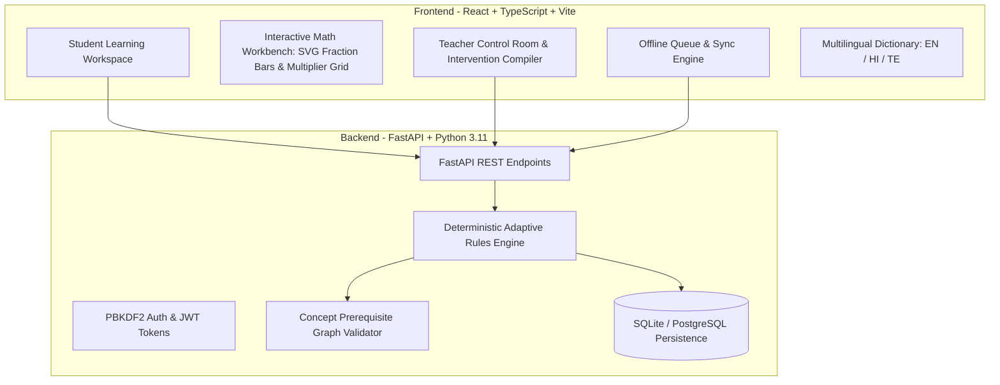

# PRISM CLASSROOM
> **Misconception-aware adaptive learning that keeps teachers at the centre.**  
> *One concept. Many learning paths. One teacher-led classroom.*  
> **Submission for Code Kernel '26 · Decode Round**

---

## 01 | Executive Overview

Students in Classes 6–10 learn at different speeds and carry diverse prerequisite foundations. End-of-chapter tests reveal learning gaps too late, while teachers managing large classes of 45–60 learners cannot easily identify individual learning barriers. Most conventional EdTech platforms attempt to replace the educator with an autonomous, black-box AI tutor.

**PRISM Classroom** is an adaptive-learning copilot designed around teacher-in-the-loop decision support. It diagnoses misconceptions using short, targeted activities, adapts the learning route (visual representation, scaffolding, or extension challenge), verifies independent transfer, and empowers teachers with its signature **Teacher Intervention Compiler**—automatically compiling individual learning evidence into an actionable, editable classroom lesson plan.

---

## 02 | The 4 Proved Learner Archetypes & Hackathon Showcase

PRISM comes pre-seeded with 4 distinct simulated learner profiles demonstrating the complete adaptive cycle for **CBSE Class VIII Mathematics (Rational Numbers & Equivalent Fractions)**:

| Learner | Archetype | Observable Diagnostic Pattern | Prescribed Adaptive Route | Signature Tool |
| :--- | :--- | :--- | :--- | :--- |
| **🟣 Aarav Sharma** (`STU-VISUAL`) | **Misconception** | Denominator-magnitude confusion (believes $1/8 > 1/3$ because $8 > 3$) | **Visual Support** | Interactive Fraction Bar Comparator |
| **🟠 Diya Patel** (`STU-FOUNDATION`) | **Prerequisite Gap** | Incomplete understanding of fraction anatomy (equal parts vs whole) | **Foundation Track** | Equal-Parts Partitioning Workbench |
| **🔵 Kabir Verma** (`STU-CALC`) | **Calculation Slips** | Understands equivalence concept but makes unequal arithmetic multiplier slips | **Guided Practice** | Scaffolded Multiplier & Simplification Grid |
| **🟢 Meera Iyer** (`STU-EXTEND`) | **Demonstrated Mastery** | Consistently accurate on standard and transfer items | **Extension Challenge** | Class VIII Kitchen Lab (Recipe Proportions) |
| **👩‍🏫 Ms. Ananya** (`TEACHER-PRISM`) | **Classroom Lead** | Reviews classroom evidence pulse across all learners | **Control Room** | Teacher Intervention Compiler |

> **Hackathon Judges Quick-Switch**: A 1-click **Persona Switcher** is pinned to the top bar, allowing instant switching between Aarav, Diya, Kabir, Meera, and Ms. Ananya without re-authenticating.

---

## 03 | Three Pillars of Adaptation (LEARN · SOLVE · TEST)

1. **LEARN (Change Visual Representation & Language)**:
   - Dynamic SVG fraction bar comparator with real-time length proofs.
   - Interactive equal-part partitioning strip.
   - Full bilingual / trilingual terminology in **English**, **Hindi (हिंदी)**, and **Telugu (తెలుగు)**.
2. **SOLVE (Scaffolded Practice)**:
   - Guided multiplier grid showing $(a \times k) / (b \times k)$.
   - Real-world NCERT Class VIII applied contexts (scaling Payasam recipes using equivalent rational proportions).
3. **TEST (Independent Transfer Verification)**:
   - Independent novel problem to verify understanding before upgrading mastery estimates.

---

## 04 | Signature Feature: Teacher Intervention Compiler

PRISM never acts as an autonomous teacher. The educator retains full professional authority:
- **Automatic Grouping Matrix**: Aggregates individual evidence into flexible small-group pods (Visual Pod, Foundation Pod, Guided Pod, Extension Pod).
- **Interactive Decision Controls**: Teachers can **Approve**, **Modify Activity / Time (5–20 min)**, **Reassign Students**, or **Dismiss / Reject** plans.
- **45-Minute Lesson Timeline Visualizer**: Dynamic pacing breakdown (Diagnostic Launch $\rightarrow$ Differentiated Pods $\rightarrow$ Independent Transfer $\rightarrow$ Whole-class Synthesis).
- **Learner Evidence Dossier**: Click any student to inspect their question-by-question attempt trail, selected choices, and triggered diagnostic rules.
- **Official CBSE Printable Briefing**: One-click printable / exportable PDF format ready for school administration or inspection.

---

## 05 | Indian Classroom Realities

- **Board & Syllabus**: Mapped to **CBSE Class VIII Mathematics (NCERT Middle Stage)**.
- **Linguistic Inclusivity**: Instant toggle across **English**, **Hindi**, and **Telugu** with authentic mathematical terminology (*Numerator/Denominator $\rightarrow$ अंश/हर $\rightarrow$ లవం/హారం*).
- **Intermittent Connectivity (Tested Offline Mode)**:
  - Built-in **Simulated Offline Mode** with local queueing in `localStorage`.
  - Seamless, idempotent sync with client-side UUIDs (`submission_id`).
- **Explainable, Deterministic Rules Engine**:
  - No black-box LLM hallucinations.
  - Transparent directed acyclic graph (DAG) of prerequisites.
  - Strict safeguards: A single error cannot establish a misconception; low-confidence triggers teacher review.

---

## 06 | Tech Stack & Architecture



- **Frontend**: React 18, TypeScript, Vite, Lucide Icons, pure modular CSS.
- **Backend**: FastAPI, SQLAlchemy, SQLite (`prism.db`), Pydantic.
- **Logic**: Deterministic rule engine (`engine.py`) with topological DAG validation.

---

## 07 | Quick Start (Run Locally)

### Prerequisites
- Node.js 20+
- Python 3.11+

### 1. Start the Backend API
Double-click `run-backend.bat`, or in PowerShell:
```powershell
cd backend
# Directly run using venv uvicorn (no script activation required):
.\.venv\Scripts\uvicorn.exe app.main:app --reload --port 8000
```
*(If you prefer activating in PowerShell, first run `Set-ExecutionPolicy -Scope Process -ExecutionPolicy Bypass` then `.\.venv\Scripts\Activate.ps1`)*

### 2. Start the Frontend UI
Double-click `run-frontend.bat`, or in a separate terminal:
```powershell
cd frontend
npm.cmd run dev
```

Open **`http://localhost:5173`** in your browser.

> **Default Demo Logins** (Password for all: `PrismDemo!2026`):
> - **Student (Aarav - Visual Route)**: `student@prism.demo`
> - **Student (Diya - Foundation Route)**: `diya@prism.demo`
> - **Student (Kabir - Guided Route)**: `kabir@prism.demo`
> - **Student (Meera - Extension Route)**: `meera@prism.demo`
> - **Teacher (Ms. Ananya - Control Room)**: `teacher@prism.demo`

---

## 08 | Automated Test Suite

Both backend and frontend contain automated unit and integration tests:

```powershell
# Backend (14 tests passed)
cd backend
.\.venv\Scripts\python -m pytest -c pytest.ini tests

# Frontend (Vitest passed + Typecheck Build passed)
cd ..\frontend
npm test
npm run build
```

---

## 09 | Code Kernel '26 Brief Alignment Matrix

| Hackathon Requirement | PRISM Implementation | Proved In Prototype |
| :--- | :--- | :--- |
| **Adaptive Learning Loop** | Diagnostic $\rightarrow$ Adaptive Learn $\rightarrow$ Guided Solve $\rightarrow$ Transfer Verification | Proved across 4 archetypes |
| **Misconception Diagnosis** | Rule-based pattern matching (e.g., denominator-magnitude, unequal operations) | Tested in `test_engine.py` |
| **Teacher Decision Support** | Teacher Intervention Compiler with editable groupings and time allocations | Proved in Teacher Control Room & `test_api.py` |
| **Indian Classroom Support** | CBSE alignment, English/Hindi/Telugu translations, tested offline queue | PWA-style offline sync toggle |
| **Explainability & Safety** | Transparent scores (not probabilities), teacher retains override authority | Safeguards enforced in engine |
