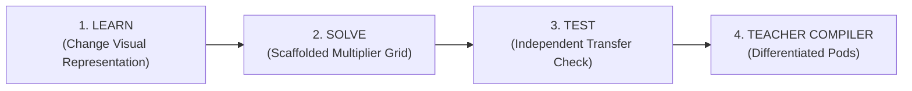
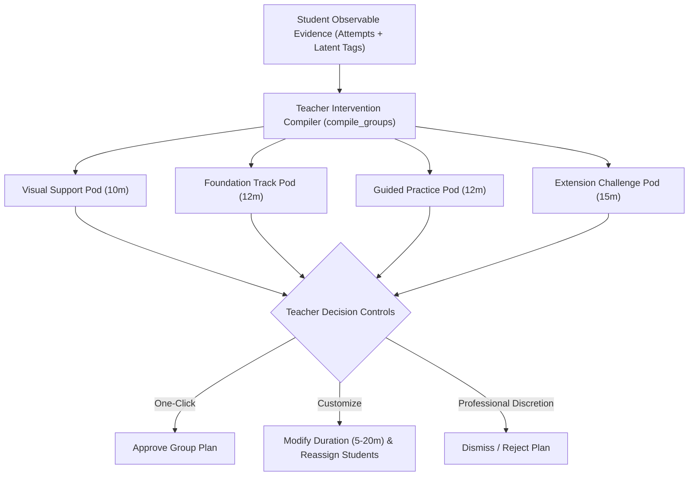
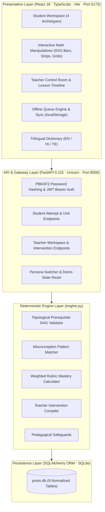

# PRISM CLASSROOM
> **Misconception-aware adaptive learning that keeps teachers at the centre.**  
> *One concept. Many learning paths. One teacher-led classroom.*  
> **Submission for Code Kernel '26 · Decode Round | Track: EdTech / Adaptive Learning**

[](https://fastapi.tiangolo.com)
[](https://react.dev)
[](https://www.typescriptlang.org)
[](https://vitejs.dev)
[](https://python.org)
[](#09--automated-test-suite)
[](LICENSE)

---

## Table of Contents
1. [Executive Overview & Problem Statement](#01--executive-overview--problem-statement)
2. [The 4 Proved Learner Archetypes](#02--the-4-proved-learner-archetypes)
3. [The Three Pillars of Adaptation (LEARN · SOLVE · TEST)](#03--the-three-pillars-of-adaptation-learn--solve--test)
4. [Signature Innovation: Teacher Intervention Compiler](#04--signature-innovation-teacher-intervention-compiler)
5. [Indian Classroom Realities & Localization](#05--indian-classroom-realities--localization)
6. [System Architecture & Visual Artifacts](#06--system-architecture--visual-artifacts)
7. [Deterministic Rules Engine & Mathematical Model](#07--deterministic-rules-engine--mathematical-model)
8. [Complete REST API Specification](#08--complete-rest-api-specification)
9. [Automated Test Suite & Verification](#09--automated-test-suite)
10. [Local Quick Start Guide](#10--local-quick-start-guide)
11. [3-Minute Demo Video Recording Script](#11--3-minute-demo-video-recording-script)
12. [Code Kernel '26 Compliance Matrix](#12--code-kernel-26-compliance-matrix)

---

## 01 | Executive Overview & Problem Statement

### The Problem in Indian Classrooms
In Classes 6–10 across Indian schools (CBSE/State Boards), teachers manage large sections of **45 to 60 learners**. Students enter the classroom with vastly diverse foundational prerequisites:
- **Summative tests reveal learning gaps too late**: Once a chapter exam is graded, the class has already moved to the next syllabus topic.
- **One-size-fits-all instruction fails both ends**: Struggling learners fall further behind, while high-mastery learners disengage from lack of challenge.
- **The flaw of conventional EdTech**: Most commercial platforms attempt to replace the educator with an autonomous, black-box AI tutor. These platforms isolate children behind headphones, generate unpredictable LLM hallucinations, and fail to provide teachers with actionable classroom decision support.

### The PRISM Solution
**PRISM Classroom** is a **teacher-in-the-loop adaptive learning copilot**. Rather than replacing the educator, PRISM acts as a continuous diagnostic and instructional assistant:
1. **Diagnoses Specific Misconceptions**: Uses short, targeted diagnostic questions that classify latent misconceptions (e.g. denominator-magnitude confusion) rather than just marking an answer "wrong".
2. **Adapts the Learning Modality**: Dynamically adjusts visual representation (interactive SVG fraction bars), provides prerequisite foundation scaffolding, or assigns extension challenges.
3. **Verifies Independent Transfer**: Validates understanding on an unguided, novel application problem before upgrading estimated mastery.
4. **Empowers the Teacher**: Automatically compiles individual evidence pulses into the **Teacher Intervention Compiler**—providing editable small-group pods, a 45-minute lesson pacing schedule, individual audit dossiers, and printable CBSE inspection briefings.

---

## 02 | The 4 Proved Learner Archetypes

PRISM comes pre-seeded with 4 distinct simulated student profiles and 1 lead teacher profile for **CBSE Class VIII Mathematics (Chapter 1: Rational Numbers & Equivalent Fractions)**:

| Learner | Archetype | Observable Diagnostic Pattern | Prescribed Adaptive Route | Signature Interactive Manipulative |
| :--- | :--- | :--- | :--- | :--- |
| **🟣 Aarav Sharma**<br/>`STU-VISUAL`<br/>`student@prism.demo` | **Misconception** | **Denominator-magnitude confusion**: Believes $1/8 > 1/3$ because whole number $8 > 3$. | **Visual Support Track** | **Interactive SVG Fraction Bar Comparator**: Side-by-side dynamic bars proving that dividing into more pieces makes each piece narrower. |
| **🟠 Diya Patel**<br/>`STU-FOUNDATION`<br/>`diya@prism.demo` | **Prerequisite Gap** | **Incomplete fraction anatomy**: Cannot distinguish equal fractional parts from unequal slices. | **Foundation Track** | **Equal-Parts Partitioning Workbench**: Hands-on virtual paper-strip folding showing equal-part denominators. |
| **🔵 Kabir Verma**<br/>`STU-CALC`<br/>`kabir@prism.demo` | **Calculation Slips** | **Arithmetic slip**: Understands equivalence concept but makes unequal arithmetic multiplier slips (e.g., $3/5 \rightarrow 5/10$). | **Guided Practice Track** | **Scaffolded Multiplier Grid**: Guided dual-term multiplication grid enforcing $(a \times k) / (b \times k)$ arithmetic balance. |
| **🟢 Meera Iyer**<br/>`STU-EXTEND`<br/>`meera@prism.demo` | **Demonstrated Mastery** | **High Transfer Ability**: Consistently solves standard and transfer problems with >85% accuracy. | **Extension Challenge** | **Class VIII Kitchen Lab**: Real-world NCERT applied context (scaling Payasam recipe ingredients using rational proportions). |
| **👩‍🏫 Ms. Ananya**<br/>`TEACHER-PRISM`<br/>`teacher@prism.demo` | **Classroom Lead** | Reviews classroom evidence pulse across all 4 learners. | **Teacher Control Room** | **Teacher Intervention Compiler**: Editable small-group pod allocations, 45-minute lesson visualizer, and CBSE export. |

> **Hackathon Judges 1-Click Persona Switcher**: A sticky **Persona Switcher** is pinned to the top navigation bar, allowing evaluators to switch instantly between Aarav, Diya, Kabir, Meera, and Ms. Ananya without re-authenticating.

---

## 03 | The Three Pillars of Adaptation (LEARN · SOLVE · TEST)

PRISM structures learning around three evidence-gathering pillars:



### 1. LEARN: Dynamic Visual Representation & Language
- When a student displays conceptual confusion, PRISM does not simply repeat text definitions. It changes the visual representation:
  - **SVG Fraction Bar Comparator**: Real-time length calculation proving $1/3$ is significantly wider than $1/8$.
  - **Paper-Strip Partitioning Tool**: Allows students to partition wholes into 2, 3, 4, 6, 8, or 12 equal slices.
  - **Trilingual Localization**: Instant toggle across **English**, **Hindi (हिंदी)**, and **Telugu (తెలుగు)** with authentic NCERT mathematical terms (*Numerator/Denominator $\rightarrow$ अंश/हर $\rightarrow$ లవం/హారం*).

### 2. SOLVE: Scaffolded Practice
- For calculation slips, PRISM mounts a step-by-step multiplier scaffold:
  - Highlights numerator and denominator multipliers simultaneously: $\frac{a \times k}{b \times k}$.
  - Color-coded validation warns if unequal multipliers are applied.

### 3. TEST: Independent Transfer Verification
- Mastery is never awarded on repetitive pattern drills alone.
- Before upgrading a student to "Demonstrated Mastery", PRISM presents an independent **novel transfer question** (e.g. recipe proportion scaling in non-standard units) weighted at **1.4×** in the engine.

---

## 04 | Signature Innovation: Teacher Intervention Compiler

PRISM guarantees that **the teacher retains 100% professional decision authority**. The system never locks students into algorithmic tracks autonomously.



### Key Control Room Capabilities:
1. **Automatic Grouping Matrix**: Aggregates individual evidence into flexible small-group pods with suggested activity descriptions, targeted outcomes, and pedagogical durations.
2. **Interactive Teacher Decisions**:
   - **Approve**: One-click endorsement of the proposed plan.
   - **Modify**: Adjust time allocation (5–20 min), edit instructional instructions, or reassign students between pods.
   - **Reject / Dismiss**: Discard suggestions that do not match the teacher's classroom observation.
3. **45-Minute Lesson Timeline Visualizer**:
   - `00–10 min`: Diagnostic Launch & Evidence Gathering
   - `10–25 min`: Differentiated Intervention Pods
   - `25–35 min`: Independent Transfer Verification
   - `35–45 min`: Whole-Class Synthesis & Reflection
4. **Learner Evidence Dossier**: Click any student in the *Classroom Evidence Pulse* to open a complete, question-by-question historical attempt audit showing prompt, student selection, expected answer, and triggered diagnostic rule.
5. **Official CBSE Printable Briefing**: One-click printable PDF format ready for school administration, academic supervisors, or inspection.

---

## 05 | Indian Classroom Realities & Localization

| Challenge in Indian Schools | PRISM Engineering Solution |
| :--- | :--- |
| **Diverse Linguistic Backgrounds** | Trilingual engine supporting English, Hindi, and Telugu. Terminology aligns with NCERT Hindi and Telugu medium textbooks (*e.g., अंश/हर, లవం/హారం*). |
| **Intermittent / Spotty Wi-Fi** | Built-in **Simulated Offline Mode** using `localStorage` queueing. Submissions carry client-side UUIDs (`submission_id`) ensuring idempotent, duplicate-free sync upon reconnection. |
| **Curriculum Compliance** | Strictly mapped to **CBSE Class VIII Mathematics (NCERT Middle Stage)**, covering rational numbers, standard form, and equivalence. |
| **AI Safety & Hallucination Risks** | **Deterministic Rules Engine**: every routing, mastery and misconception decision is produced by rubric formulas over a validated prerequisite DAG, with no model in the loop — see `engine.py`. The separate Answer Engine solves symbolically by default and only calls an LLM when `GEMINI_API_KEY` is explicitly configured; that fallback is off in the default deployment and never influences learner routing. |

---

## 06 | System Architecture & Visual Artifacts



### Visual Architecture & Submission Flowchart
High-resolution architecture and project flowcharts are generated directly in the repository:
- **Interactive Project Flowchart (SVG / HTML5)**: [`project_flowchart.html`](file:///c:/Users/kasiv/PRISM_CLASSROOM/project_flowchart.html) *(with layer toggles, closed-loop workflow, prerequisite DAG graph, and schema views)*.
- **Interactive Architecture Viewer**: [`architecture_diagram.html`](file:///c:/Users/kasiv/PRISM_CLASSROOM/architecture_diagram.html).
- **Online Flowchart View (Live Web)**: Accessible at `/flowchart.html` or through the in-app **Project Flowchart** navigation tab.
- **10-Minute Google Meet Technical Defense Guide**: [`INTERVIEW_DEFENSE.md`](file:///c:/Users/kasiv/PRISM_CLASSROOM/INTERVIEW_DEFENSE.md) *(Master technical script with trade-off analyses, data flow walkthroughs, and judge Q&A drills)*.

---

### AEO, GEO & Search Engine Optimization
PRISM is fully optimized for Answer Engines and Generative Search Engines:
- **AEO (Answer Engine Optimization)**: Schema.org JSON-LD structured data for `EducationalOrganization`, `Course`, `WebApplication`, and `FAQPage` embedded in [`index.html`](file:///c:/Users/kasiv/PRISM_CLASSROOM/frontend/index.html).
- **GEO (Generative Engine Optimization)**: Full implementation of the AI crawler specification at [`llms.txt`](file:///c:/Users/kasiv/PRISM_CLASSROOM/frontend/public/llms.txt) and [`llms-full.txt`](file:///c:/Users/kasiv/PRISM_CLASSROOM/frontend/public/llms-full.txt) for GPTBot, PerplexityBot, and ClaudeBot.
- **SEO (Search Engine Optimization)**: Semantic HTML5, canonical URLs, Open Graph tags, Twitter cards, XML sitemap ([`sitemap.xml`](file:///c:/Users/kasiv/PRISM_CLASSROOM/frontend/public/sitemap.xml)), and crawler policy ([`robots.txt`](file:///c:/Users/kasiv/PRISM_CLASSROOM/frontend/public/robots.txt)).

---

## 07 | Deterministic Rules Engine & Mathematical Model

All pedagogical logic lives in [`backend/app/engine.py`](file:///c:/Users/kasiv/PRISM_CLASSROOM/backend/app/engine.py).

### 1. Prerequisite Dependency Graph (DAG)
The concept graph enforces prerequisite mastery:
```python
CONCEPT_GRAPH = {
    "fraction-parts": [],
    "fraction-magnitude": ["fraction-parts"],
    "simplification": ["fraction-parts"],
    "equivalent-fractions": ["fraction-magnitude", "simplification"],
}
```
On application startup, `validate_graph()` traverses the graph and raises an exception if any dependency cycle or missing parent node is detected.

### 2. Mastery Scoring Formula
Mastery is a rubric score bounded between $[0.05, 0.95]$:

$$Mastery = \text{round}\left(\max\left(0.05, \min\left(0.95, 0.25 \times M_{prev} + 0.75 \times \frac{\sum w_i \cdot c_i}{\sum w_i}\right)\right), 2\right)$$

- $w_i = 1.0$ for diagnostic and practice items.
- $w_i = 1.4$ for transfer test items ($40\%$ higher evidentiary weight).
- $c_i \in \{0, 1\}$ denotes correctness.

### 3. Pedagogical Safeguards
- **Single-Error Protection**: A single incorrect answer never assigns a misconception label.
- **Confidence Floor**: A misconception label requires at least $2$ matching observable error tags and $\ge 50\%$ relative occurrence.
- **Teacher Review Fallback**: Ambiguous or mixed responses route the learner to `follow-up` (Teacher Conference Pod).

---

## 08 | Complete REST API Specification

| Method | Endpoint | Access Role | Description |
| :--- | :--- | :--- | :--- |
| `GET` | `/api/health` | Public | Service health probe. Returns `{"status": "ok"}`. |
| `POST` | `/api/auth/login` | Public | Authenticates credentials; returns JWT token and user profile. |
| `POST` | `/api/auth/register` | Public | Creates student or teacher account; provisions classroom. |
| `GET` | `/api/auth/me` | Authenticated | Returns current authenticated session identity. |
| `GET` | `/api/curriculum` | Public | Declared CBSE Class VIII curriculum and learning goals. |
| `GET` | `/api/learning/units` | Public | Returns the 8 active CBSE learning units. |
| `GET` | `/api/learning/my-progress` | Student | Returns the authenticated student's progress across all units. |
| `GET` | `/api/learning/units/{id}/questions` | Student | Returns questions for a specific unit and stage (`diagnostic`, `practice`, `test`). |
| `POST` | `/api/learning/attempts` | Student | Submits an attempt; updates mastery and misconception state with client UUID deduplication. |
| `POST` | `/api/students/join-classroom` | Student | Enrolls a real student into a teacher's classroom by code. |
| `GET` | `/api/teacher/workspace` | Teacher | Returns live student progress, classroom metrics, and compiled interventions. |
| `GET` | `/api/teacher/students/{code}/detail` | Teacher | Returns a student's full historical attempt trail and triggered diagnostic rules. |
| `GET` | `/api/teacher/interventions` | Teacher | Retrieves compiled small-group intervention plans. |
| `POST` | `/api/teacher/interventions/recompile` | Teacher | Recompiles intervention pods dynamically from live student attempt evidence. |
| `PUT` | `/api/teacher/interventions/{id}` | Teacher | Modifies intervention duration, activity, outcome, student assignment, or status. |
| `GET` | `/api/demo/personas` | Public | Returns metadata for the 4 student archetypes and lead teacher. |
| `POST` | `/api/demo/reset` | Demo mode only | Resets database to pristine pre-seeded demonstration state. Returns 404 when `PRISM_DEMO_MODE=0`. |

---

## 09 | Automated Test Suite

The project includes unit and integration test coverage across both backend and frontend:

### Backend Test Suite (Pytest)
```powershell
cd backend
.\.venv\Scripts\pip install -r requirements-dev.txt   # runtime deps + pytest
.\.venv\Scripts\python -m pytest -c pytest.ini tests
```
**Results: 169 passed in ~1s**
- `test_student_attempt_and_idempotency`: Verifies UUID deduplication and attempt grading.
- `test_teacher_can_view_and_decide_intervention`: Verifies teacher approval, notes, and overrides.
- `test_project_declares_a_single_cbse_curriculum`: Validates CBSE Class 8 curriculum declaration.
- `test_authentication_exposes_a_multi_chapter_student_catalogue`: Validates multi-chapter progression.
- `test_teacher_workspace_contains_rich_learner_profiles`: Tests evidence aggregation across 4 archetypes.
- `test_student_detail_and_attempt_history`: Validates learner dossier attempt trail.
- `test_demo_personas_and_reset`: Verifies 1-click persona switching and state reset.
- `test_join_classroom_and_real_data_enrollment`: Verifies real student enrollment by class code.
- `test_recompile_interventions_from_live_evidence`: Verifies dynamic real-time pod re-clustering on live attempts.
- `test_graph_validation`: Confirms acyclic DAG validation catches cycles.
- `test_single_error_does_not_tag_misconception`: Enforces pedagogical safeguard against premature labeling.
- `test_repeated_misconception_routes_to_visual_support`: Verifies Aarav's visual route prescription.
- `test_prerequisite_gap_routes_to_foundation`: Verifies Diya's foundation strip route prescription.
- `test_calculation_slip_routes_to_guided_practice`: Verifies Kabir's guided multiplier route prescription.
- `test_transfer_success_routes_to_extension`: Verifies Meera's recipe scaling route prescription.
- `test_mixed_evidence_routes_to_follow_up`: Verifies teacher conference fallback.
- `test_compiler_groups_using_rules_not_student_names`: Verifies `compile_groups` uses rules, not hardcoded student names.
- `test_compiler_groups_skips_pre_diagnostic_profiles`: Verifies robustness — pre-diagnostic profiles are safely excluded from grouping.

**Prerequisite DAG routing** (`test_engine.py`)
- `test_ancestors_are_transitive` / `test_ancestors_of_unmodelled_concept_is_empty`: Validates traversal of the concept graph.
- `test_prerequisite_mastery_ignores_unattempted_nodes`: An unattempted prerequisite is unknown, not weak.
- `test_unknown_prerequisite_never_forces_foundation`: Prevents false foundation routing before evidence exists.
- `test_weak_prerequisite_routes_to_foundation_with_measured_reason`: Foundation fires on a measured prerequisite score and reports it.

**Derived profiles** (`test_derived_profiles.py`) — guards the claim that no profile is hand-written
- `test_every_seeded_profile_is_reproducible_from_attempts`: Re-deriving from raw attempts reproduces every stored profile exactly.
- `test_demo_archetypes_are_engine_outputs_not_fixtures`: All four archetypes fall out of the rules engine.
- `test_foundation_route_is_reachable_from_prerequisite_evidence`: Foundation comes from real DAG evidence, not a seeded value.
- `test_no_profile_exists_without_supporting_attempts`: Every profile is backed by recorded attempts.

**Question bank integrity** (`test_catalog_tags.py`) — 100 parametrised checks
- Every tagged distractor exists among its question's options, is not the correct answer, and has an entry in the misconception database.
- `test_every_chapter_can_diagnose_at_least_one_misconception`: Diagnosis is not Chapter-1-only.

**Access control** (`test_security.py`)
- `test_anonymous_caller_cannot_resolve_a_teacher`: No credential-free path to classroom data.
- `test_demo_header_is_rejected_outside_demo_mode` / `test_demo_only_endpoints_are_disabled_outside_demo_mode`: `PRISM_DEMO_MODE` gating.
- `test_auth_secret_is_mandatory_outside_demo_mode`: Refuses to boot production on the public development secret.
- `test_spa_handler_contains_path_traversal`: Static file handler cannot escape the build directory.

### Frontend Test Suite (Vitest & TypeScript Build)
```powershell
cd frontend
npm test
npm run build
```
**Results: 6 tests passed in Vitest; TypeScript build clean (0 errors).**

Covers routing (every advertised path resolves to its own page), per-route title/description/canonical uniqueness, the public landing page at `/`, and the sign-in screen at `/app`.

---

## 09b | Public Routes & Environment Contract

### Routes
Each path below is a real, linkable, crawlable URL with its own `<title>`, meta
description and canonical tag, and each appears in `sitemap.xml`.

| Path | Page | Indexable |
| :--- | :--- | :--- |
| `/` | Landing page — public marketing content | Yes (priority 1.0) |
| `/curriculum` | CBSE Class VIII curriculum explorer | Yes |
| `/engines` | Engines Studio (search / answer / generative) | Yes |
| `/flowchart` | System architecture flowchart | Yes |
| `/faq` | Help & FAQ (AEO/GEO question-answer surface) | Yes |
| `/app` | Learner and teacher workspace (sign-in gated) | Low priority |

Crawlers that do not execute JavaScript receive a `<noscript>` summary linking
every route, alongside `/llms.txt` and `/llms-full.txt`.

### Environment variables

| Variable | Default | Purpose |
| :--- | :--- | :--- |
| `DATABASE_URL` | `sqlite:///./prism.db` | Database location. The container points this at `/data` so a mounted disk survives redeploys. |
| `PRISM_DEMO_MODE` | `1` | `1` keeps the public persona endpoints, the `X-Demo-Teacher` header and `POST /api/demo/reset` available for judging. Set `0` for any deployment holding real learner data. |
| `PRISM_AUTH_SECRET` | dev fallback | Bearer-token signing secret. **Mandatory** when `PRISM_DEMO_MODE=0` — the fallback value is committed to this repository, so a deployment using it can be impersonated. |
| `CORS_ORIGINS` | localhost | Comma-separated exact origins allowed cross-origin. Unnecessary for the unified container, which serves the SPA same-origin. |
| `CORS_ORIGIN_REGEX` | unset | Optional pattern alternative. Scope it to your own subdomain, never a whole shared host. |
| `GEMINI_API_KEY` | unset | Enables the optional LLM fallback in the Answer Engine. Leave unset to use the deterministic solver only. Never affects learner routing. |

---

## 09c | Deployment

Frontend and backend deploy as **one** Render web service: the Dockerfile
builds the React bundle and FastAPI serves it alongside `/api/*` on a single
port, so there is no second service and no cross-origin setup.

```bash
git push -u origin <branch>
# render.com -> New -> Blueprint -> connect this repo -> Apply
```

Render reads `render.yaml` and configures the runtime, health check and every
environment variable, generating a random `PRISM_AUTH_SECRET` on first deploy.

**One caveat worth knowing before judging:** Render free instances have an
ephemeral filesystem and cannot mount a persistent disk, so SQLite is
recreated (and the demo reseeded) whenever the instance restarts or wakes from
idle. `DEPLOY.md` documents two durable alternatives — free managed Postgres,
or a disk on a paid instance — both of which are a config change only.

See **[DEPLOY.md](DEPLOY.md)** for the step-by-step walkthrough, the full
environment-variable table, local Docker instructions and troubleshooting.

---

## 10 | Local Quick Start Guide

### Prerequisites
- **Node.js**: v20 or higher
- **Python**: v3.11 or higher
- **Git**

### Automated Startup (Windows)
1. **Start Backend**: Double-click [`run-backend.bat`](file:///c:/Users/kasiv/PRISM_CLASSROOM/run-backend.bat) (starts FastAPI on `http://127.0.0.1:8000`).
2. **Start Frontend**: Double-click [`run-frontend.bat`](file:///c:/Users/kasiv/PRISM_CLASSROOM/run-frontend.bat) (starts Vite on `http://localhost:5173`).
3. Open `http://localhost:5173` in your browser.

### Manual Startup (PowerShell)
```powershell
# Terminal 1: Backend
cd backend
.\.venv\Scripts\uvicorn.exe app.main:app --reload --port 8000

# Terminal 2: Frontend
cd frontend
npm.cmd run dev
```

### Pre-Configured Demo Credentials
All accounts share the password: `PrismDemo!2026`

| Persona | Role | Email | Password | Pre-seeded Condition |
| :--- | :--- | :--- | :--- | :--- |
| **🟣 Aarav Sharma** | Student | `student@prism.demo` | `PrismDemo!2026` | Denominator Misconception (Visual Route) |
| **🟠 Diya Patel** | Student | `diya@prism.demo` | `PrismDemo!2026` | Prerequisite Part-Whole Gap (Foundation Route) |
| **🔵 Kabir Verma** | Student | `kabir@prism.demo` | `PrismDemo!2026` | Calculation Slips (Guided Multiplier Route) |
| **🟢 Meera Iyer** | Student | `meera@prism.demo` | `PrismDemo!2026` | High Mastery (Recipe Scaling Extension Route) |
| **👩‍🏫 Ms. Ananya** | Teacher | `teacher@prism.demo` | `PrismDemo!2026` | Lead Teacher (Intervention Compiler & Dossier) |

*(Alternatively, use the 1-click **Persona Switcher** in the top navigation bar to bypass the login form entirely).*

---

## 11 | 3-Minute Demo Video Recording Script

> **Target Speed**: ~130–140 words per minute (~410 spoken words across 3 minutes).

| Time | Screen | Action | Voiceover Script |
| :--- | :--- | :--- | :--- |
| **0:00–0:35** | Home Screen | Hover over top Persona Switcher | *"In a typical Indian classroom of 50 students, learners progress at vastly different speeds. Traditional EdTech tries to replace educators with black-box AI tutors that isolate students behind screens. Meet **PRISM Classroom**—an adaptive learning copilot built on one core principle: keep the teacher at the centre of every instructional decision. Mapped to CBSE Class 8 Mathematics, PRISM diagnoses learning barriers using short, targeted activities, prescribes tailored visual tools, and empowers educators with our signature Teacher Intervention Compiler."* |
| **0:35–1:30** | Aarav (`STU-VISUAL`) | Switch to Aarav, adjust fraction bar to $1/3$ and $1/8$, toggle Hindi, click Offline | *"Let’s step into the shoes of Aarav Sharma. Aarav believes $1/8$ is larger than $1/3$ because $8 > 3$. PRISM’s deterministic engine detects this specific misconception. Instead of generic text explanations, it adapts the learning surface with this Interactive Fraction Bar Comparator. As Aarav adjusts partitions, the SVG strips visually prove that more parts make each piece narrower. For Indian classrooms, PRISM supports trilingual mathematical vocabulary in English, Hindi, and Telugu, along with robust offline queueing so learning never stops during Wi-Fi drops."* |
| **1:30–2:30** | Ms. Ananya (Teacher) | Switch to Teacher, show 45-min timeline, click Modify on Visual Pod, open Aarav's Dossier | *"Now let’s switch to lead teacher, Ms. Ananya. Here in the Teacher Control Room, PRISM compiles individual evidence into the Teacher Intervention Compiler. Notice that PRISM never unilaterally directs the classroom. Ms. Ananya can review proposed small-group pods, adjust time allocations between 5 and 20 minutes, reassign learners, or modify pedagogical activities with one click. Need to justify an intervention? Clicking on any learner opens their transparent Evidence Dossier, displaying every attempt, choice, and triggered diagnostic rule—completely explainable, with zero AI hallucinations."* |
| **2:30–3:00** | Export Plan Modal | Click `Export Plan`, show CBSE Printable Briefing | *"When the lesson plan is finalized, one click exports an official CBSE Classroom Intervention Briefing, ready for school administration or inspection. Under the hood, PRISM runs on FastAPI, a validated prerequisite DAG, and a responsive React frontend. PRISM Classroom: One concept, many adaptive learning paths, and one teacher-led classroom. Thank you!"* |

---

## 12 | Code Kernel '26 Next Round Challenge Compliance Matrix

| Next Round Challenge Criteria | PRISM Implementation & Technical Deliverable | Prototype & Code Verification |
| :--- | :--- | :--- |
| **1. Website Development & Required Pages** | Full multi-page experience: **Landing Page**, **Curriculum & DAG Explorer**, **Project Flowchart Viewer**, **AEO/GEO Knowledge Hub (FAQ)**, and **Interactive Student/Teacher Workspaces**. | Live navigation in `frontend/src/Pages.tsx` and `App.tsx`. |
| **2. AEO (Answer Engine Optimization)** | Schema.org JSON-LD structured data for `FAQPage`, `Course`, `EducationalOrganization`, and `WebApplication`. Optimized for Google AI Overviews and voice search queries. | Verified in `frontend/index.html` via Schema validator. |
| **3. GEO (Generative Engine Optimization)** | Official `llms.txt` and `llms-full.txt` standard files for AI crawlers (PerplexityBot, GPTBot, ClaudeBot) providing high information-density markdown knowledge graphs. | Verified at `/llms.txt` and `/llms-full.txt`. |
| **4. SEO (Search Engine Optimization)** | Semantic HTML5 tags, canonical tags, Open Graph previews, Twitter card meta, XML sitemap, and crawler robot directives. | Verified at `/robots.txt` and `/sitemap.xml`. |
| **5. Product Improvement & UX** | Trilingual instant toggle (EN/HI/TE), interactive SVG fraction bar comparators, 45-minute lesson pacing scheduler, learner attempt dossiers, and printable CBSE briefings. | Verified across student and teacher interfaces. |
| **6. Real Data Implementation** | Real database persistence (SQLite `prism.db`): real user registration, teacher classroom creation (`CLASS-XXXX`), student enrollment by code (`POST /api/students/join-classroom`), and dynamic real-time pod re-clustering (`POST /api/teacher/interventions/recompile`). No dummy simulations. | Verified in `test_api.py` and live workspace. |
| **7. Project Flowchart (50% Submission)** | High-resolution interactive visual SVG flowchart covering client ingestion, offline queueing, API gateway, deterministic DAG engine, and teacher decision loops. | Standalone [`project_flowchart.html`](file:///c:/Users/kasiv/PRISM_CLASSROOM/project_flowchart.html) and live in-app tab. |
| **8. Technical Interview Prep (50% Interview)** | Comprehensive 10-minute Google Meet master interview defense guide covering architecture rationale, data collection/storage, challenges & solutions, and competitive superiority. | Fully documented in [`INTERVIEW_DEFENSE.md`](file:///c:/Users/kasiv/PRISM_CLASSROOM/INTERVIEW_DEFENSE.md). |

---

*PRISM Classroom is developed for Code Kernel '26. Built with FastAPI, React, TypeScript, and SQLite.*
