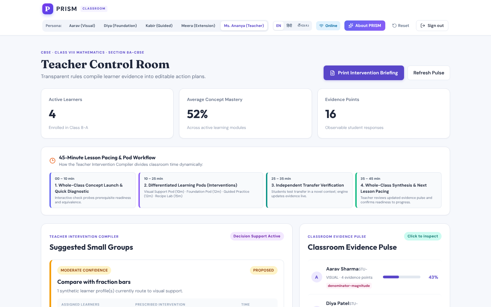

# PRISM Classroom

Misconception-aware adaptive learning that keeps teachers at the centre.

[](https://github.com/vamshimohan-777/PRISM_CLASSROOM/actions/workflows/ci.yml)

Prototype for the **Code Kernel '26 Decode round**. It covers one complete
adaptive loop for one topic, CBSE Class VIII equivalent fractions, using four
simulated learners and one teacher.



## The problem

Students in Classes 6–10 arrive with different prior knowledge. A missed
prerequisite makes later topics harder, end-of-chapter tests find gaps late,
and a teacher with a large class cannot track every learner. PRISM connects
diagnosis to action: it estimates what a learner understands, suggests a
route, checks the result with a new problem, and helps the teacher plan for
the shared needs of the class.

## What the prototype does

1. **Diagnose.** A short diagnostic tags each wrong option with the
   misconception or slip it suggests.
2. **Adapt.** An ordered set of rules picks a route: visual support,
   foundation work, guided practice, extension, or a teacher follow-up when
   the evidence conflicts.
3. **Verify.** An independent transfer question updates the estimate.
4. **Hand over to the teacher.** The *Teacher Intervention Compiler* groups
   learners by route into draft small-group plans. The teacher approves,
   edits, reassigns or rejects each plan.

| Learner (simulated) | Evidence pattern | Route |
| --- | --- | --- |
| Aarav | Repeats "larger denominator means a larger fraction" | Visual support: fraction-bar comparator |
| Diya | Error on fraction parts, a prerequisite | Foundation: equal-parts workbench |
| Kabir | Concept answers correct, arithmetic slips | Guided practice: multiplier grid |
| Meera | Correct on the independent transfer problem | Extension: recipe scaling |

These routes are **derived** by the rules engine from each learner's seeded
answers, and a test checks that they match the intended archetypes. See the
[worked traces](docs/rules-engine.md#worked-traces-for-the-four-simulated-learners).

### Safeguards

- A single wrong answer never produces a label. A pattern must repeat.
- Conflicting evidence goes to the teacher instead of being guessed.
- Procedural slips are not reported as misconceptions.
- Estimates are per concept and recomputed on every answer. Nothing is stored
  as a permanent label such as "weak" or "slow".
- Every plan starts as *Proposed*, and only the teacher can act on it.

### Built for Indian classrooms

- Interface terminology in English, Hindi and Telugu.
- Mapped to one CBSE Class VIII unit, with NCERT as the reference text. This
  is not an official CBSE product.
- Answers given offline are queued on the device and synced without
  duplicates. Production builds cache the app shell with a service worker.

## Run it locally

You need Python 3.11+ and Node.js 20+.

**macOS / Linux**

```bash
scripts/setup.sh   # once: virtualenv, demo data, npm packages
scripts/dev.sh     # API on :8000, web app on :5173
```

**Windows**

```powershell
cd backend
python -m venv .venv
.\.venv\Scripts\pip install -r requirements-dev.txt
cd ..\frontend
npm ci
```

Then start `scripts\run-backend.bat` and `scripts\run-frontend.bat`.

Open <http://localhost:5173>. The demo classroom is seeded on first start.
Every account uses the password `PrismDemo!2026`:

| Account | Email |
| --- | --- |
| Aarav (visual route) | `student@prism.demo` |
| Diya (foundation route) | `diya@prism.demo` |
| Kabir (guided route) | `kabir@prism.demo` |
| Meera (extension route) | `meera@prism.demo` |
| Ms. Ananya (teacher) | `teacher@prism.demo` |

When signed in, the top bar switches between accounts. **Reset** restores
the seeded classroom.

Configuration is read from environment variables. See
[`.env.example`](.env.example).

## Tests

```bash
scripts/check.sh   # ruff, pytest, vitest and a production build, as in CI
```

The backend suite includes one test class for each measure in section 07 of
the submission: diagnostic consistency, route appropriateness, transfer
check, teacher control and the offline path. See
[docs/evaluation.md](docs/evaluation.md).

## Repository layout

```
backend/
  app/engine.py      rules, concept map, intervention library
  app/main.py        FastAPI routes
  app/seed.py        simulated classroom and learner answers
  tests/             engine, API and evaluation tests
frontend/
  src/App.tsx        student workspace and teacher control room
  src/InteractiveTools.tsx   fraction bars, partition strip, multiplier grid
  src/TeacherModals.tsx      plan editing and learner dossier
  public/sw.js       offline app-shell cache
docs/                architecture, rules engine, evaluation, demo script
scripts/             setup, dev and check helpers
```

## Documentation

- [Architecture](docs/architecture.md): components, API and offline flow
- [Rules engine](docs/rules-engine.md): the decision table and worked traces
- [Evaluation](docs/evaluation.md): how each submission measure is tested
- [Demo walkthrough](docs/demo-script.md): a five-minute script

## Scope

This is a prototype run on simulated learners. It checks that the software
behaves as designed. It does **not** show diagnostic accuracy with real
students, effectiveness across boards and languages, or learning gains. Those
need proper evaluation with school permission. Only the equivalent-fractions
topic has misconception-tagged questions. The other seven chapters use plain
question sets.

## Why rules instead of a trained model?

There is no validated student-response data to train on. A short rule list
is faster to build, easy to test, and easy for a teacher or reviewer to read
and challenge. Any future language-model assistance would be optional and
limited to reviewed content.
