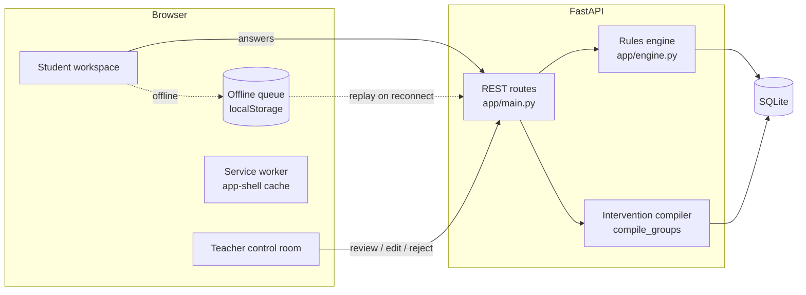

# Architecture

The stack follows the plan in section 06 of the submission, choosing one
option wherever the plan offered two:

| Layer | Submission plan | This repository |
| --- | --- | --- |
| Frontend | React / Next.js | React 19 + TypeScript, built with Vite |
| Backend | FastAPI or Express | FastAPI |
| Adaptive logic | Python rules engine + concept map | `app/engine.py` |
| Content | Curated JSON bank | Python literals in `app/seed.py` and `app/catalog.py` |
| Storage | SQLite initially | SQLite through SQLAlchemy (`DATABASE_URL`) |
| Offline | PWA caching + local queue | `public/sw.js` + a `localStorage` queue in `App.tsx` |

## Backend layout

| File | Responsibility |
| --- | --- |
| `app/main.py` | HTTP routes, auth dependencies, first-run seeding |
| `app/engine.py` | Concept map, error tags, ordered rules, intervention library |
| `app/seed.py` | Simulated classroom: questions, four learners, their answers |
| `app/catalog.py` | Eight Class VIII chapters and their plain question sets |
| `app/curriculum.py` | CBSE/NCERT reference metadata and disclaimer |
| `app/auth.py` | PBKDF2 password hashing and HMAC-signed bearer tokens |
| `app/models.py` | SQLAlchemy tables |

## Main API routes

| Method | Path | Who | Purpose |
| --- | --- | --- | --- |
| POST | `/api/auth/login` | anyone | Exchange email and password for a token |
| GET | `/api/learning/units` | anyone | Chapter catalogue |
| GET | `/api/learning/units/{id}/questions?stage=` | student | Questions for a stage |
| POST | `/api/learning/attempts` | student | Submit an answer. Idempotent on `submission_id` |
| GET | `/api/teacher/workspace` | teacher | Class summary and learner profiles |
| GET | `/api/teacher/students/{code}/detail` | teacher | One learner's answer trail |
| GET | `/api/teacher/interventions` | teacher | Proposed small-group plans |
| PUT | `/api/teacher/interventions/{id}` | teacher | Approve, modify, reassign or reject a plan |
| POST | `/api/demo/reset` | demo | Restore the seeded classroom |

The full interactive schema is at `http://localhost:8000/docs` while the API
is running.

## Answer flow

1. The student submits an answer with a client-generated `submission_id`.
2. The API stores it, unless that `submission_id` already exists for the
   student. A duplicate returns `{"duplicate": true}` and changes nothing.
3. All of the student's answers for the concept are turned into evidence and
   passed to `update_profile()`.
4. The new profile (mastery, route, reason) is stored and returned with the
   response.

## Authentication and roles

Passwords are hashed with PBKDF2-SHA256 (210,000 iterations). Tokens are
HMAC-SHA256 signed and expire after 8 hours. Set `PRISM_AUTH_SECRET` outside
local demos. Teacher routes require a teacher token. With
`PRISM_DEMO_MODE=1` (the default), an unauthenticated `X-Demo-Teacher` header
is also accepted so scripted demos work. Set `PRISM_DEMO_MODE=0` to turn that
off, along with first-run seeding.

## Offline behaviour

- **App shell:** production builds register `sw.js`, which caches the page and
  hashed assets. API responses are never cached.
- **Answers:** while offline (detected from browser events, or toggled by
  hand), answers go to a `localStorage` queue. Sync replays them in order,
  removes each one only after the server accepts it, and keeps the rest if a
  request fails. Server-side de-duplication makes retries safe.
